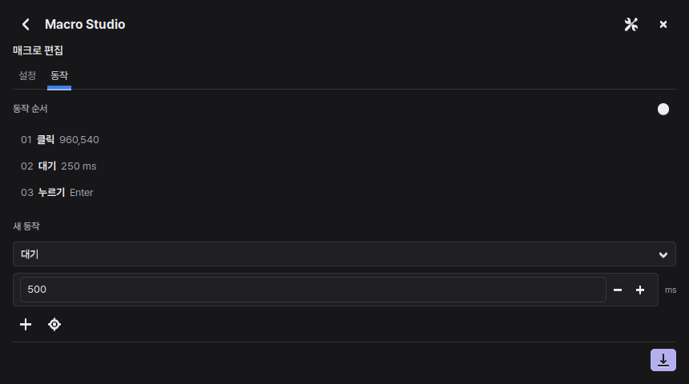
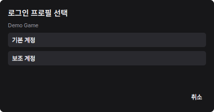
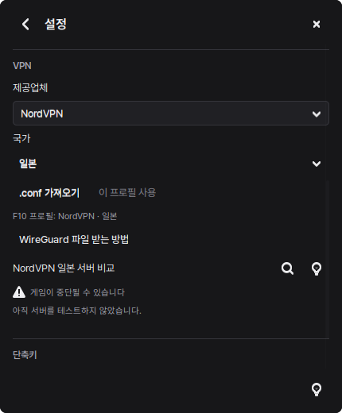
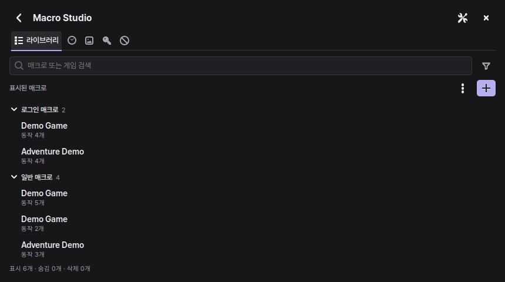

<h1 align="center">GFN Flow</h1>

  <strong>게임별 매크로와 로그인을, F9 하나로.</strong> 
  GeForce NOW를 위한 Windows · Linux 데스크톱 유틸리티

  
  
  

  <a href="https://github.com/Mangom72/GFN_Flow/releases/latest"><strong>다운로드</strong></a>
  · <a href="docs/INSTALL.md">설치 가이드</a>
  · <a href="#처음-사용하기">빠른 시작</a>
  · <a href="docs/README.en.md">English</a>

  

가상 데이터로 촬영한 실제 앱 화면입니다. 새 설치에는 등록된 게임·계정·매크로가 없습니다.

## 게임에 맞춘 동작을 한곳에서

GFN Flow는 실행 중인 GeForce NOW 게임을 감지하고, 해당 게임에 등록한 매크로를 보여줍니다. 로그인이나 반복 입력을 직접 편집하거나 녹화하고, 게임 화면에서 F9로 실행·중지할 수 있습니다.

| 기능 | 할 수 있는 일 |
| --- | --- |
| **게임별 매크로** | 키 입력·클릭·이동·대기를 편집하고 녹화한 동작을 재생합니다. |
| **첫 F9 로그인** | 게임 세션의 첫 F9에 로그인 매크로를 실행할지 설정합니다. |
| **동일 게임 다계정** | 하나의 매크로에서 계정만 바꿉니다. 계정이 둘 이상일 때만 선택창이 열립니다. |
| **화면 인식 워크플로** | 등록한 이미지가 보이는지에 따라 다음 동작을 정합니다. |
| **VPN 프로필** | Windows에서 제공업체와 국가별 WireGuard 설정을 저장하고 F10으로 연결합니다. |
| **게임 블랙리스트** | 감지에서 제외한 게임을 관리하고, 차단 해제와 복구를 선택합니다. |

한국어·영어 UI, Pretendard 글꼴, 창 크기와 페이지 애니메이션 설정을 제공합니다.

## 처음 사용하기

1. [최신 릴리스](https://github.com/Mangom72/GFN_Flow/releases/latest)의 ZIP을 풀고 [플랫폼별 설치 가이드](docs/INSTALL.md)를 따릅니다.
2. GeForce NOW 앱에서 게임을 실행한 뒤 스튜디오에 로그인 매크로나 일반 매크로를 등록합니다.
3. 게임에 포커스를 두고 **F9**를 누릅니다. 실행 중 F9를 다시 누르면 중지합니다.

> [!TIP]
> **설정 → F9 동작**에서 창이 열리는 조건을 항상 / GFN 실행 중 / GFN 포커스 중 / GFN 게임 실행 중으로 고를 수 있습니다. 첫 F9 로그인을 끄면 매크로 목록부터 열립니다.

### 같은 게임에 계정 추가하기

**스튜디오 → 로그인 정보**에서 기존 로그인 매크로를 선택하고 **프로필 추가**를 누릅니다. 동작 순서는 그대로 두고 계정 이름·아이디·비밀번호를 따로 등록합니다.

계정이 하나면 기존처럼 바로 실행합니다. 둘 이상이면 자동 로그인과 수동 실행 모두에서 계정을 선택합니다. 선택창을 취소해도 첫 F9 로그인 기회는 남습니다.

  

## 필요한 연결만 설정

Windows VPN 설정에서는 **NordVPN · Proton VPN Free/Plus · Mullvad · Surfshark**의 단일 서버 WireGuard `.conf`를 등록할 수 있습니다. 사용할 국가와 서버는 제공업체에서 받은 파일로 정해집니다.

**설정 → VPN**에서 제공업체와 국가를 선택하고 파일을 가져온 뒤 **이 프로필 사용**을 누릅니다. 국가 목록은 한글·영문 이름과 두 글자 코드로 검색할 수 있습니다.

<strong>VPN 설정 화면과 설치 조건</strong>

  

WireGuard와 전용 VPN 서비스를 처음 설치할 때 관리자 권한이 필요합니다. 설치 후 프로필 등록·변경과 F10 연결은 일반 사용자 권한으로 동작합니다. GFN 경로를 설정하고 일반 인터넷의 기본 경로는 유지합니다.

[Windows VPN 설치 가이드](docs/INSTALL.md#windows-vpn-선택-사항)를 참고하십시오. Linux는 기존 NetworkManager 기반 일본 VPN 설정을 사용합니다.

## 자주 쓰는 단축키

| 키 | 동작 |
| --- | --- |
| <kbd>F9</kbd> | 로그인·매크로 목록 열기 / 실행 중지 |
| <kbd>F10</kbd> | 선택한 VPN 연결·해제 |
| <kbd>F12</kbd> | Windows에서 GFN 창에 포커스가 있을 때 모바일 핫스팟 전환 |
| <kbd>Ctrl</kbd> + <kbd>1</kbd>–<kbd>5</kbd> | 스튜디오의 다섯 탭 이동 |
| <kbd>Esc</kbd> | 이전 화면으로 이동 |

<strong>스튜디오 화면과 탭 전환 보기</strong>

  

**설정 → 화면 전환 애니메이션**을 끄면 즉시 전환합니다. 키보드로도 탭을 선택할 수 있습니다. [정지 화면 보기](docs/images/studio.png)

## 계정 정보와 내보내기

아이디와 비밀번호는 Windows 자격 증명 관리자 또는 Linux Secret Service에 저장합니다. 추가 계정 프로필은 매크로 내보내기에 포함하지 않습니다.

일반 **텍스트 입력** 동작은 내보내기에 포함되므로, 로그인에는 **저장된 아이디·비밀번호** 동작을 사용하십시오. [라이선스](LICENSE)와 [타사 구성 요소 안내](THIRD_PARTY_NOTICES.md)도 확인할 수 있습니다.

---

  <a href="docs/INSTALL.md">설치 가이드</a> ·
  <a href="https://github.com/Mangom72/GFN_Flow/releases">릴리스 내역</a> ·
  <a href="https://github.com/Mangom72/GFN_Flow/issues">문제 신고</a>

