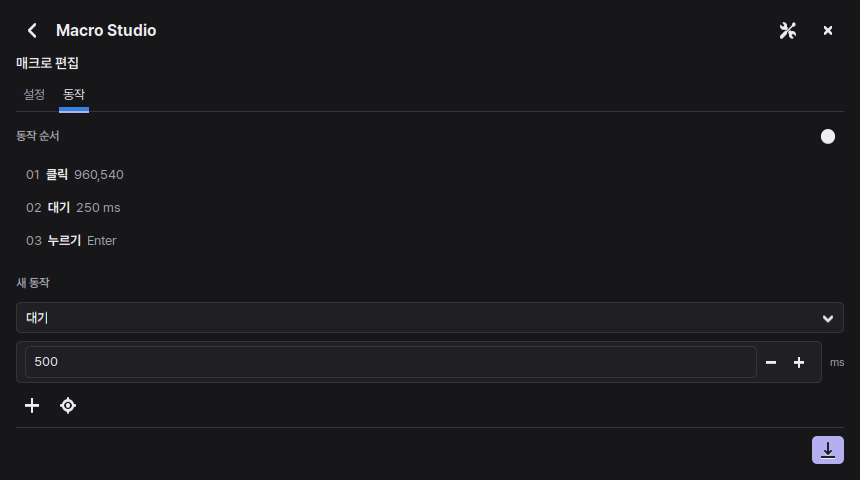
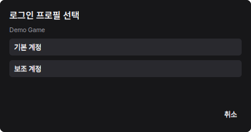
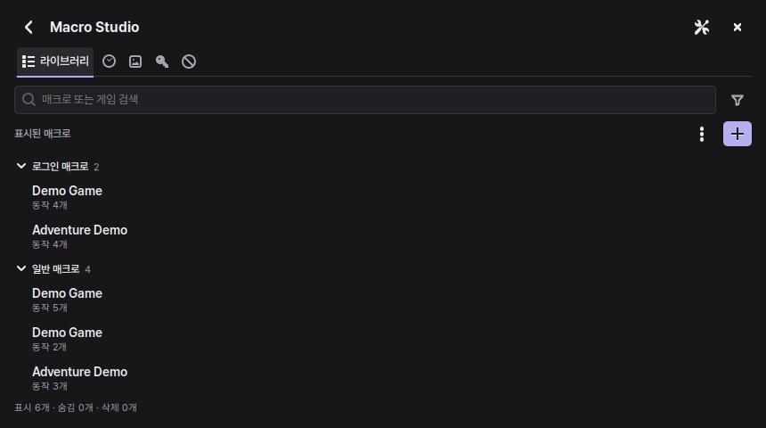

<h1 align="center">GFN Flow</h1>

  <strong>One key for the macros you use in each game.</strong> 
  A GeForce NOW desktop utility for Windows and Linux with Hyprland

  
  
  

  <a href="https://github.com/Mangom72/GFN_Flow/releases/latest"><strong>Download</strong></a>
  · <a href="INSTALL.en.md">Install</a>
  · <a href="#quick-start">Quick start</a>
  · <a href="../README.md">한국어</a>

  

Actual app screens with sample data. A fresh install has no saved games, accounts, or macros.

## What you can do

| Feature | What it does |
| --- | --- |
| **Game macros** | Edit or record input sequences and play them back in the matching game. |
| **First-F9 login** | Run a game's enabled login macro on the first F9 press of a session. |
| **Multiple accounts** | Reuse one login macro and choose an account only when it has more than one. |
| **Visual workflows** | Use an image match to decide which action to run next. |
| **VPN profiles** | Save Windows WireGuard profiles by provider and country, then toggle the active one with F10. |
| **Game blacklist** | Exclude a detected game, unblock it, or restore it to the library. |

Macro Studio has English and Korean interfaces, Pretendard typography, three window sizes, and an option to turn off page animations.

## Quick start

1. Extract the ZIP from [Releases](https://github.com/Mangom72/GFN_Flow/releases/latest) and follow the [installation guide](INSTALL.en.md).
2. Launch a game in GeForce NOW. Open Macro Studio and create a login or normal macro for that game.
3. Focus the game and press **F9**. Press F9 again during playback to stop it.

> [!TIP]
> In **Settings → F9 behavior**, choose when F9 can open the picker. Turn off **Run login macro on first F9** to open the list without logging in.

### Multiple accounts for one game

Open **Login Credentials**, select the existing login macro, and choose **Add profile**. Profiles share the macro's actions and have separate credentials.

One account runs directly. With two or more, automatic and manual runs both show an account picker. Canceling leaves the first-F9 attempt available.

  

## Optional VPN

On Windows, import a single-server WireGuard configuration from **NordVPN, Proton VPN Free or Plus, Mullvad, or Surfshark**. Open **Settings → VPN**, select a provider and country, import the file, then choose **Use profile**. The country menu accepts local or English names and two-letter codes.

WireGuard and the GFN Flow VPN service require administrator access for initial installation. F10, profile changes, and the NordVPN Japan comparison run as a regular user afterward. The VPN service changes the GFN routes and leaves the default internet route in place. See [VPN setup](INSTALL.en.md#windows-vpn-optional).

## Shortcuts

| Key | Action |
| --- | --- |
| <kbd>F9</kbd> | Open the picker or stop playback |
| <kbd>F10</kbd> | Toggle the active VPN |
| <kbd>F12</kbd> | Toggle Windows Mobile Hotspot while a GeForce NOW window is focused |
| <kbd>Ctrl</kbd> + <kbd>1</kbd>–<kbd>5</kbd> | Switch Studio tabs |
| <kbd>Esc</kbd> | Go back |

<strong>See the Studio tabs in motion</strong>

  

Turn off **Page animations** for instant switching. [View the still image](images/studio.png).

## Credentials and exports

Account IDs and passwords are stored in Windows Credential Manager or Linux Secret Service. Additional account profiles are omitted from macro exports. Ordinary text actions are included, so use the saved-credential actions for sign-in.

[MIT license](../LICENSE) · [Third-party notices](../THIRD_PARTY_NOTICES.md) · [Report an issue](https://github.com/Mangom72/GFN_Flow/issues)
